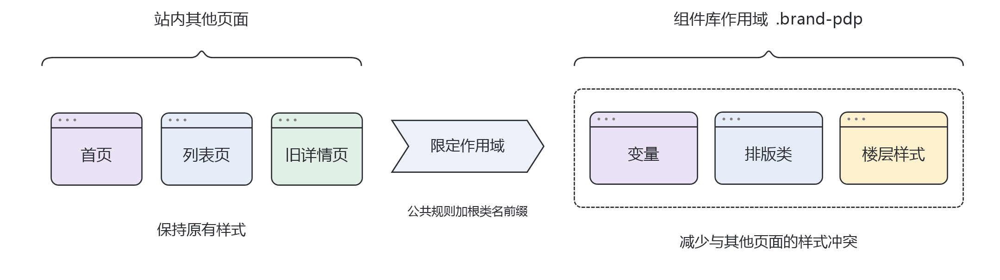
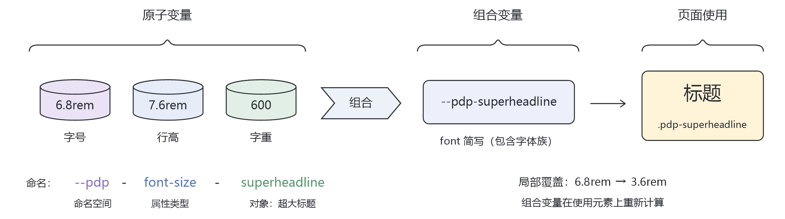
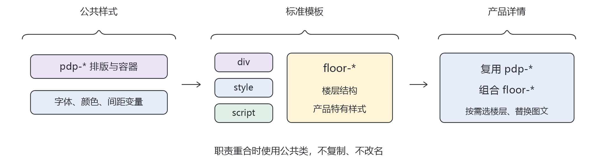
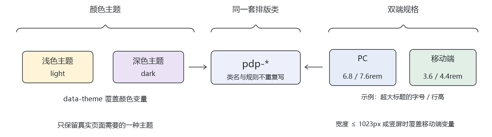
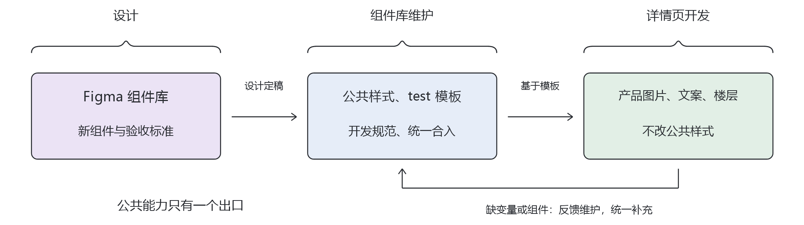
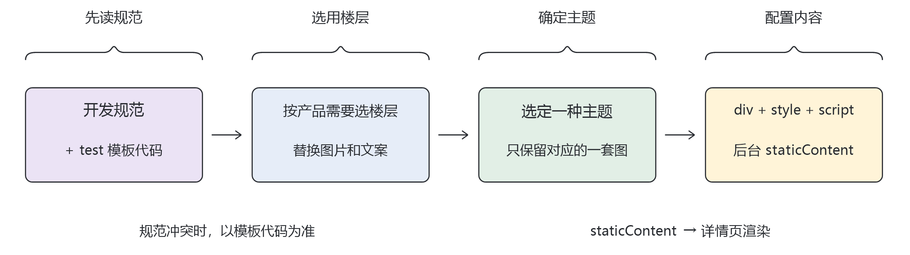

## 为什么要做组件库？

由于过去我们的产品详情页是高度定制的，几乎每个详情页的中每个楼层的动画都是不同的，这就导致楼层之间的动画很难复用。唯一可以复用的只能是每个品牌的字体、主题颜色等。这就导致每次详情页的开发投入的成本比较高。

中间也尝试过很多次的组件库的设计，但是定制化的问题摆在面前，始终无法解决。于是退而求其次，开发过一期动画模板，这个模板主要是总结了详情页中用到的主流动画都有哪些？包括动画的演示、代码、以及介绍等。想法也是很简单就是每次开发详情页的时候去动画模板中找相似的动画，把代码 copy 过来，改动改动，目的是减少了一个动画从零开发的时间。

上面的动画模板虽然对于详情页提效有一定的帮助，但是由于动画的数量有 100 多个，导致对于新人来说每次需要花费大量的时候去找模板，熟悉代码。

再后来，AI 的出现，让详情页的开发变得容易，但是同时带来了新的问题。比如生成的代码质量参差不齐，每次生成完后审查代码需要花费大量的时间，而且 AI 会生成很多的无用代码，导致想微调一个动画的时候代码很难看懂。

其实这次组件库要解决的就是这件事，约束 AI 的生成，提供标准的模板。

## 设计思路

### 一、先圈定作用域

组件库的样式只由品牌站详情页路由引入，所有规则都挂在同一个根类名之下。这样做有两个好处：不会影响站内其他页面，也不会被旧详情页的样式反过来污染。



### 二、变量的设计

变量是整个组件库的地基。设计时主要考虑三件事：名字怎么起、分几层、定义在哪里。

> 下面示例中的 `.brand-pdp` 代指根类名。

**1. 命名方式**

变量统一按 **「命名空间 - 类型 - 对象 - 修饰符」** 命名。 以 `--pdp-font-size-superheadline` 为例：

- `--pdp`：命名空间，表示它属于详情页组件库。
- `font-size`：类型，说明它控制的是字号。
- `superheadline`：对象，指超大标题。

名字有规律的好处是可以推导：需要超大标题的行高时，不用查文档也能猜到是 `--pdp-line-height-superheadline`。这一点对 AI 同样有效，它能自己找到该用的变量，而不是随手写一个数值。

**2. 分三层，从原子到语义**



```css
.brand-pdp {
  /* 基础值：只描述“是什么”，不带业务含义 */
  --font-black-headline: #1a1a1a;
  --spacing-24: 2.4rem;

  /* 语义变量：描述“用在哪”，一个变量只控制一个属性 */
  --pdp-text-color-headline: var(--font-black-headline);
  --pdp-font-size-superheadline: 6.8rem;
  --pdp-line-height-superheadline: 7.6rem;
  --pdp-font-weight-superheadline: 600;
}
```

第三层是**组合变量**，把同一种字体的字重、字号、行高、字体族聚合成一个 `font` 简写，再交给同名的排版类使用：

```css
--pdp-superheadline: var(--pdp-font-weight-superheadline)
  var(--pdp-font-size-superheadline)/var(--pdp-line-height-superheadline) var(--pdp-font-family);

.brand-pdp .pdp-superheadline {
  font: var(--pdp-superheadline);
  color: var(--pdp-text-color-headline);
}
```

到了页面里，只需要写 `<h1 class="pdp-superheadline">`，字号、行高、字重、颜色一次到位。

#### 3. 组合变量定义在每个元素上

组合变量没有和其他变量一起定义在根节点，而是定义在根节点和它的所有后代上。 原因是 CSS 变量在定义它的元素上就完成了计算，后代继承到的是计算后的结果。

举个例子：假设某个楼层想把超大标题调小，只在该楼层覆盖 `--pdp-font-size-superheadline`。

- 如果组合变量定义在根节点，它早已按 `6.8rem` 算完，楼层里的覆盖不会生效；
- 定义在每个元素上，它会在使用的地方重新计算，覆盖一个原子变量就够了。

### 三、模板的设计

模板是组件库的第二部分。公共样式解决 **“用什么”** ，模板解决 **“怎么写”** 。



#### 1. 模板是一个完整的示范页面

模板只有根 div、style、script 三部分，和真实详情内容的形态完全一致，拿来就能用。 里面一共十个楼层，每个楼层示范一种版式：主视觉、卖点卡片、通用图文、多 Tab 轮播、横向滑动的说明、参数列表、产品包装。开发新页面时按需选用，不需要的整块去掉。

#### 2. 公共类和楼层类各管各的

- `pdp-*`：公共类，负责页面、内容容器和九级排版。
- `floor-*`：模板类，只负责公共样式没有覆盖的楼层结构。其中 `floor-container`、`floor-title` 这类是多个楼层共用的，`floorN-语义名称` 是某个楼层专属的。

两者职责重合时一律用公共类，不复制、不改名。这条规则保证了规范调整时只需要改一个地方。

以通用图文楼层为例：

```html
<div class="pdp-page floor-page" data-theme="light">
  <div class="floor-common floor3-container">
    <div class="floor-text">
      <h2 class="pdp-headline animation-item">标题</h2>
      <h3 class="pdp-subhead animation-item">副标题</h3>
      <p class="pdp-body-l animation-item">正文</p>
    </div>
    <picture class="floor-image floor-image-light">
      <source media="(max-width: 1023px), (orientation: portrait)" srcset="移动端图片" />
      
    </picture>
  </div>
</div>
```

- 根节点同时有 `pdp-page` 和 `floor-page`：前者启用公共排版，后者是模板样式的作用域。
- 标题、副标题、正文没有写任何字号，全部来自 `pdp-*` 排版类。
- 上浮动画只加一个 `animation-item`，由公共库处理，模板里不写 JS。
- `floor-common` 是通用图文的共用结构，`floor3-container` 留给这个楼层自己的差异。

#### 3. 明暗两套图片放在一起

模板要同时演示浅色和深色，所以每张图都有 `floor-image-light` 和 `floor-image-dark` 两份，由根节点的 `data-theme` 决定显示哪一份。真实详情页只有一种主题，开发时保留对应的一套即可。

#### 4. 模板本身就是规范

模板里的代码刻意保持同一种写法：

- 尺寸用 rem
- 选择器最多两层且全部用类名
- 不写没被用到的属性
- 多个 Tab 的显示隐藏都用同一组 `active` 和 `hide`

AI 读完模板后照着写，生成的代码风格自然就统一了，审查代码的时间也就省下来了。

### 四、主题和双端靠变量切换



颜色变量默认是浅色，根节点设置 `data-theme="dark"` 后整页切到深色，样式里不写死任何色值。

```css
.brand-pdp {
  --pdp-text-color-headline: var(--font-black-headline);
}

.brand-pdp .pdp-page[data-theme='dark'] {
  --pdp-text-color-headline: var(--font-white-headline);
}
```

双端同理：宽度不超过 1023px 或竖屏时进入移动端规格，媒体查询里只覆盖字号、行高、间距这些变量，排版类本身不需要写第二遍。

```css
@media (max-width: 1023px), (orientation: portrait) {
  .brand-pdp {
    --pdp-font-size-superheadline: 3.6rem;
    --pdp-line-height-superheadline: 4.4rem;
  }
}
```

### 五、交互能少则少

能用 CSS 完成的不写 JS：上浮动画由公共库统一处理，横向滑动的楼层直接用浏览器原生滚动。 只有轮播这类必须用脚本的地方才引入 Swiper，并统一封装成一个方法，各楼层调用方式一致。

## 后期分工



组件库上线后，工作会分为三块：

| 角色       | 负责什么                                                                  |
| ---------- | ------------------------------------------------------------------------- |
| 设计       | 维护 Figma 组件库和验收标准，新组件、新规格先在设计侧定稿                 |
| 组件库维护 | 维护公共样式、test 环境的模板和开发规范文档；新增变量和组件由这里统一合入 |
| 详情页开发 | 基于模板产出具体产品的详情内容，只写产品特有的楼层样式，不改公共样式      |

边界只有一条：**公共的东西只有一个出口**。 详情页开发中发现缺变量或缺组件，先反馈给组件库维护补到公共层和模板里，而不是在自己的页面里临时加一份。

## 如何使用



开发一个新的产品详情页，流程是固定的：

1. 让 AI 先读两处规范：项目内的开发规范文档，以及 test 环境的模板代码。
2. 按产品需要从模板中选用楼层，替换图片和文案。
3. 确定主题，只保留对应主题的一套图片。
4. 产出的内容只包含根 div、style、script 三部分，配置到后台 `staticContent` 后由详情页渲染。

> 让 AI 先读模板是关键一步。模板本身就是规范的可执行版本：命名、结构、样式、脚本怎么写，代码里都有现成的例子，比任何文字说明都准确。

## 小结

组件库的价值不在于某个楼层写得多漂亮，而在于三件事： **规范只有一个出处，改动只有一个入口，新页面只有一种起点。** 前期多花的时间，会在之后每一个详情页上省回来。
